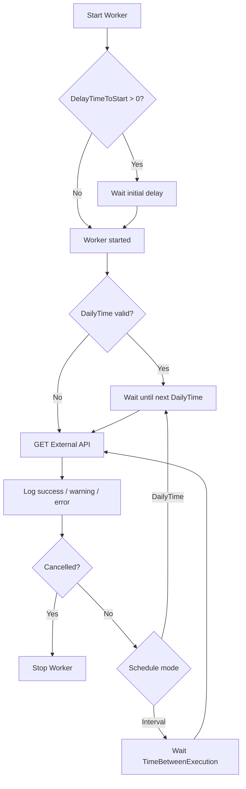

# Daily HTTP Request Worker
This worker is designed to run daily at 3 AM and perform an HTTP request to an external API. 
It's a simple background process built with .NET, ideal for automating daily integrations or data pulls.

## How it works



## How to run locally
1. Clone this repository
2. Restore dependencies

```bash
dotnet restore
```
3. Run the application:
```bash
dotnet run
```

The worker will execute the request and then finish.
1. Clone this repository
2. Restore dependencies

```bash
dotnet restore
```
3. Run the application:
```bash
dotnet run
```

The worker will execute the request and then finish.
