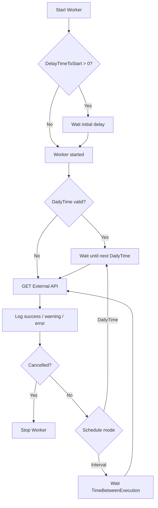

# Worker.SendNotification
A .NET 10 background worker that GETs an external API on a daily schedule or a fixed interval.

## 🗺️ How it works


## 📦 Requirements
- 🟦 [.NET 10 SDK](https://dotnet.microsoft.com/download)

## 🗂️ Solution
`Worker.Recurrence.sln` has two projects:

```text
.
├── Worker.Recurrence.sln
├── Worker.SendNotification.csproj   # worker
├── Program.cs
├── WorkerService.cs
├── Configuration/
│   ├── ExternalApi.cs
│   └── HostedSetting.cs
├── appsettings.json
├── appsettings.Development.json
└── Worker.SendNotification.Tests/
    └── Worker.SendNotification.Tests.csproj
```

## ▶️ Run locally
From the repo root:

```bash
dotnet restore
dotnet run --project Worker.SendNotification.csproj
```

It keeps running until you stop it (Ctrl+C). Local runs use `DOTNET_ENVIRONMENT=Development` from `Properties/launchSettings.json`, so `appsettings.Development.json` overrides `appsettings.json`.

```bash
dotnet build Worker.Recurrence.sln
dotnet test Worker.SendNotification.Tests/Worker.SendNotification.Tests.csproj
```

## ⚙️ Configuration
Settings live in `appsettings.json` (and `appsettings.Development.json` locally).

**ExternalApi** - URL the worker GETs (`BaseAddress` + `Path`):

| Key | Default (`appsettings.json`) |
| --- | --- |
| `BaseAddress` | `https://jsonplaceholder.typicode.com/` |
| `Path` | `posts` |

That is `GET https://jsonplaceholder.typicode.com/posts`.

**HostedSetting** - when it runs:

| Key | Meaning |
| --- | --- |
| `DelayTimeToStart` | Seconds to wait before the first run |
| `DailyTime` | If a valid `HH:mm:ss` (default `03:00:00`), run once a day at that time |
| `TimeBetweenExecution` | Milliseconds between runs when `DailyTime` is missing or invalid (default `86400000` = 24h) |

HTTP calls use a 30s timeout and Polly retries (3 attempts, exponential backoff). This is a worker host, not a web API - no listen port, Swagger, or HTTP health URL.
